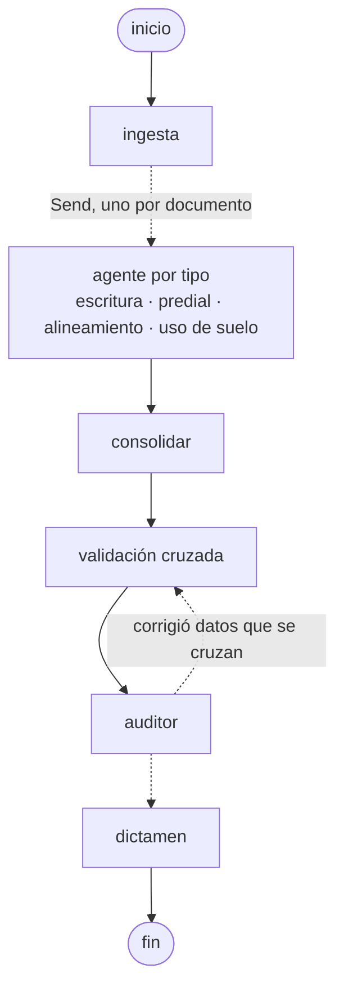

# Hack3B · Reto 1 Expedientes

Sistema multiagente en LangChain y LangGraph que revisa el expediente legal de un inmueble, detecta faltantes e inconsistencias y emite una recomendación con evidencia. Lo construimos en un día, el 21 de noviembre de 2026, en el hackathon de Tiendas 3B (Reto 1 · Expedientes), un equipo de 5 personas. El enunciado está en [CONTEXT.md](CONTEXT.md).

## Contenido

- [Qué hace](#qué-hace)
- [Arquitectura](#arquitectura)
- [Cómo correrlo](#cómo-correrlo)
- [Contrato de datos](#contrato-de-datos)
- [Equipo](#equipo)
- [Notas del hackathon](#notas-del-hackathon)

## Qué hace

La entrada es el expediente de un inmueble con 4 tipos de documento: escritura, predial, alineamiento y número oficial, y uso de suelo. Acepta PDF e imágenes (`png`, `jpg`, `tif`), escaneados o con texto.

La salida es un dictamen con una de dos recomendaciones, una confianza, un resumen, las razones y los hallazgos. Cada dato y cada hallazgo lleva su evidencia: archivo, página y cita literal.

- **Cumple**: se cumplen todos los requisitos evaluados y los documentos coinciden entre sí.
- **Requiere revisión**: falta un tipo de documento, hay documentos ilegibles, o hay hallazgos o inconsistencias que alguien debe revisar.

El sistema recomienda y la abogada decide. El dictamen no emite "No cumple": `PERMITIR_RECHAZO_AUTOMATICO` está en `False` en `expedientes/agentes/dictamen.py`, así que un hallazgo bloqueante se reporta como "posible motivo de rechazo", va primero en las razones y deja el expediente en Requiere revisión. En la interfaz, la abogada registra su propia decisión (Aprobado, En revisión o Rechazado) con un comentario obligatorio, independiente de la recomendación del sistema (`ui/decisiones.py`).

## Arquitectura

`expedientes/orquestador.py` arma un `StateGraph` de LangGraph (`python -c "from expedientes import orquestador as o; print(o.diagrama())"`):



- **Agentes por tipo** (LLM): extraen los datos con cita literal y evalúan las reglas de su tipo. Corren en paralelo, un documento por agente (máximo `MAX_AGENTES_PARALELO`, 5 por defecto).
- **Cruce**: compara propietario, dirección, superficie, clave catastral y número oficial entre documentos. También detecta documentos que parecen de otro inmueble (`CRU-INM`).
- **Auditor** (`expedientes/agentes/auditor.py`, sin LLM): contrasta lo que reportó cada agente contra el texto original del documento. AUD-01 comprueba que la cita exista en la página indicada. AUD-02 comprueba que el valor aparezca en la página, solo para superficie, clave catastral y número oficial. AUD-03 baja a revisión un hallazgo bloqueante cuya evidencia no aparece en el documento. Cada intervención queda como hallazgo `EXP-AUD`. Si descarta datos que se cruzan, el cruce se repite (máximo 2 rondas de auditoría). En los 6 expedientes analizados (24 documentos) revisó 350 datos sin falsos positivos.
- **Dictamen**: consolida por tipo y decide con reglas fijas, sin LLM, para que el resultado sea repetible. Un agente o una lectura que fallan no tumban el expediente: el documento sale con un hallazgo `EXP-ERROR` o `EXP-INGESTA`.

## Cómo correrlo

El análisis llama a la API de Anthropic, así que necesita tu propia `ANTHROPIC_API_KEY`. Los documentos del reto no están en el repositorio.

```bash
python -m venv .venv
source .venv/bin/activate        # en Windows: .\.venv\Scripts\activate
pip install -r requirements.txt
cp .env.example .env             # en Windows: copy .env.example .env
python -m pytest -q
python -m streamlit run app.py
```

`python configurar.py` hace los mismos pasos de preparación (entorno virtual, dependencias, `.env` y pruebas).

Pega tu `ANTHROPIC_API_KEY` en `.env`. El proveedor y el modelo se cambian con `LLM_PROVIDER` y `LLM_MODEL` (`expedientes/config.py`); `.env.example` usa `claude-haiku-5-5`. Las pruebas (`pytest`) no llaman a la API.

> **Ojo con el modelo:** si `.env` no define `LLM_MODEL`, `expedientes/config.py` usa `claude-opus-5-5`, que cuesta unas 40 veces más que Haiku. Copiar `.env.example` tal cual evita el problema.

### Probarlo sin gastar créditos

La interfaz carga los dictámenes de `ejemplos/` al abrir, marcados como "Ejemplo", y no necesita API key para mostrarlos. En la pantalla de nuevo análisis, "Abrir dictamen de ejemplo" abre el de `ejemplos/dictamen_ejemplo.json`. El interruptor "Incluir ejemplos" los muestra u oculta. Son datos inventados.

### Analizar un expediente propio

En el menú lateral, sube los archivos del expediente desde la pantalla de nuevo análisis. Cada análisis llama a la API: los agentes usan el modelo configurado y, si un archivo no está en el caché OCR (`cache/`, que no se versiona), la ingesta lo lee con el modelo con visión.

También puedes llamarlo desde Python:

```python
from pathlib import Path
from expedientes.orquestador import analizar_expediente

dictamen = analizar_expediente([Path("escritura.pdf"), Path("predial.pdf")])
print(dictamen.recomendacion, dictamen.resumen)
```

## Contrato de datos

`expedientes/schemas.py` es la fuente de verdad. Los agentes, el cruce, el dictamen y la interfaz se hablan solo con estos objetos:

```
archivo ─► ingesta.leer_documento()      ─► DocumentoLeido       (texto por página, tipo, legibilidad)
        ─► <tipo>.analizar(doc, ctx)     ─► DocumentoAnalizado   (datos con evidencia + hallazgos del documento)
        ─► cruce.validar_cruzado(docs)   ─► list[Inconsistencia] (qué dice cada documento y dónde)
        ─► dictamen.dictaminar(...)      ─► Dictamen             (recomendación, confianza, explicación)
orquestador.analizar_expediente(rutas) encadena todo. La UI solo consume Dictamen.
```

Todo dato y todo hallazgo lleva `Evidencia`; sin evidencia no hay hallazgo. Un documento `ILEGIBLE` no extrae datos y sus reglas salen `NO_EVALUABLE`. Las reglas completas del contrato están en las [notas del hackathon](docs/notas-del-hackathon.md#contrato).

## Equipo

| Persona | Área |
| :--- | :--- |
| Juan Pablo | Uso de suelo, dictamen, Langfuse |
| Julián | Predial, ingesta, escritura, auditor, orquestador, caché OCR |
| Diego | Alineamiento, cruce |
| Carlos | Configuración (`config.py`) e interfaz, con Yordi |
| Yordi | Interfaz en Streamlit (`app.py`, `ui/`): bandeja de expedientes con mapa por entidad, nuevo análisis, detalle del dictamen y recorrido guiado |

## Notas del hackathon

[`docs/notas-del-hackathon.md`](docs/notas-del-hackathon.md) es la bitácora de trabajo del equipo durante el día: decisiones, presupuesto de la API, caché OCR y plan por horas.
